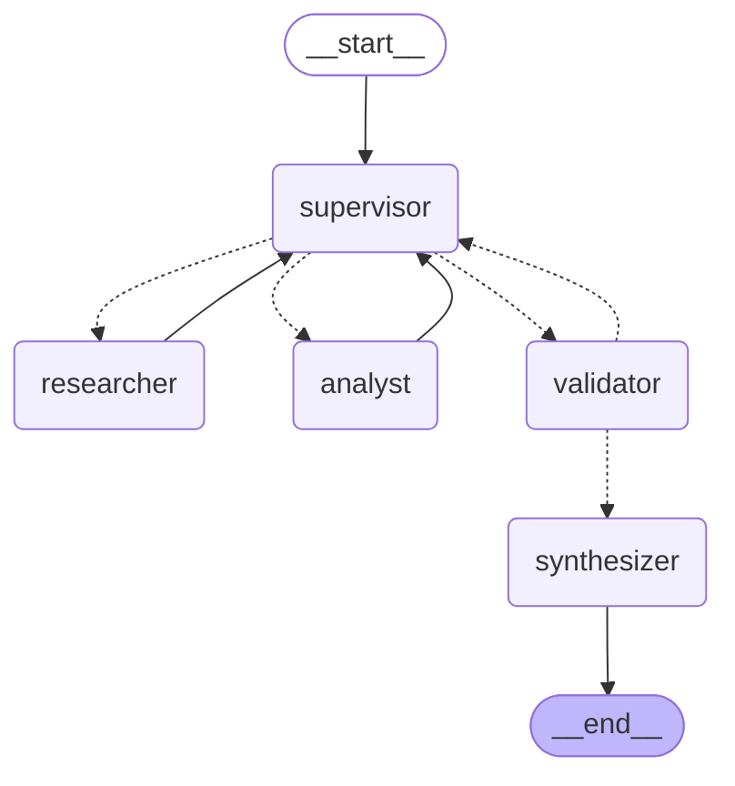

# Orquestador Multi-Agente (LangGraph) — Pre-entrega 6

Prototipo de un **Orquestador Multi-Agente de Análisis e Investigación**: un Supervisor recibe una consulta, delega en un agente Investigador y un agente Analista, valida el resultado contra una rúbrica y recién ahí sintetiza la respuesta final.

## Topología



*(Líneas punteadas = aristas condicionales. Se regenera con `python main.py --diagram`, que guarda `graph.mmd` y, si hay red, `graph.png`.)*

| Nodo | Rol | Herramientas |
|---|---|---|
| `supervisor` | Router: decide `researcher` / `analyst` / `FINISH` con salida estructurada (Pydantic + `Literal`) | — |
| `researcher` | Recupera datos crudos | `search_knowledge_base` (búsqueda simulada sobre `data/knowledge_base.json`), `web_search` (Tavily, solo si hay `TAVILY_API_KEY`) |
| `analyst` | Procesa los datos | `sentiment_analysis`, `calculate` (AST seguro, sin `eval`), `validate_schema` |
| `validator` | Valida contra la rúbrica antes del END | — |
| `synthesizer` | Redacta la respuesta final | — |

## Por qué esta topología

**Jerárquica con supervisor central** (en vez de agentes que se hablan entre sí) porque:

- **Control de flujo en un solo lugar:** toda decisión de "quién sigue" pasa por el supervisor, lo que hace el flujo auditable y fácil de depurar.
- **Especialistas simples y acotados:** cada uno tiene pocas tools y un prompt que le prohíbe invadir el rol del otro (el Investigador no calcula, el Analista no busca).
- **Escala bien:** sumar un tercer especialista = un nodo nuevo + una opción en el `Literal` del supervisor.

## Estado compartido (`state.py`)

`OrchestratorState` hereda de `MessagesState` y agrega campos estructurados:

- `contributions`: lista de `{agent, step, content}` con reducer `operator.add` → cada agente **suma** su aporte sin pisar el de otros. Responde "qué agente aportó qué" sin parsear el chat.
- `next_agent`, `instruction`: decisión y orden puntual del supervisor.
- `step_count`, `max_steps`, `revisions`: contadores anti-bucle.
- `validation_feedback`, `task_completed`, `final_answer`.

## Cómo se manejan los conflictos y los errores comunes

| Riesgo | Mitigación |
|---|---|
| **Supervisor infinito** | `max_steps` (tope duro, corta sin llamar al LLM) + `MAX_REVISIONS = 2` en el validador. Si se agota cualquiera, el validador cierra con una salvedad explícita en vez de seguir. |
| **Contaminación de contexto** | Los especialistas **no** reciben el historial: el Investigador ve solo su instrucción (+ feedback); el Analista ve su instrucción + únicamente los aportes del Investigador. El supervisor ve la consigna, un resumen truncado de aportes y el feedback. |
| **Decisiones incoherentes del LLM** | Guardas determinísticas en `supervisor.py`: no se puede analizar ni finalizar sin datos investigados, ni finalizar sin análisis. |
| **Conflicto/contradicción entre agentes** | El validador revisa consistencia entre aportes (criterio 5 de la rúbrica). Si rechaza, el feedback indica qué agente corrige y el supervisor lo re-delega. |
| **Cierre sin validar** | `FINISH` nunca va directo a `END`: siempre pasa por `validator` → `synthesizer`. |

### Rúbrica de validación (`prompts.py`)

1. Cobertura (el Investigador aportó datos relevantes) · 2. Cómputo (el Analista usó herramientas) · 3. Trazabilidad (cada cifra sale de los datos) · 4. Completitud (se responde toda la consigna) · 5. Consistencia entre aportes.

El supervisor la usa en su prompt para decidir `FINISH` y el validador para aprobar.

## Proveedor de LLM

El grafo **no depende de un proveedor**: todo pasa por `llm.py:get_llm()`. Se cambia con una variable de entorno, sin tocar código:

```bash
LLM_PROVIDER=gemini      # default (GOOGLE_API_KEY)
LLM_PROVIDER=groq        # GROQ_API_KEY
LLM_PROVIDER=openai      # OPENAI_API_KEY
LLM_PROVIDER=anthropic   # ANTHROPIC_API_KEY
LLM_MODEL=...            # opcional, fuerza un modelo puntual
```

Funciona igual con OpenAI o Anthropic (solo requiere instalar su paquete, ver `requirements.txt`). El proveedor/modelo con el que se generó la traza de ejemplo debe indicarse en la sección "Traza de ejemplo" más abajo.

> Nota: el grafo corre en modo síncrono (`invoke`/`stream`) y sin checkpointer, porque es un prototipo de una sola consulta. Para persistir conversaciones habría que sumar un checkpointer (`SqliteSaver` en entorno síncrono, `AsyncSqliteSaver` si se pasa a `ainvoke`).

## Estructura

```
state.py            # esquema del estado compartido
llm.py              # fábrica de LLM (multi-proveedor)
prompts.py          # prompts + rúbrica
supervisor.py       # nodo supervisor
validator.py        # nodo validador + sintetizador
graph.py            # StateGraph y aristas condicionales
main.py             # demo con traza de delegación
agents/
  research_agent.py # create_react_agent + tools de búsqueda
  analyst_agent.py  # create_react_agent + tools de cómputo
data/knowledge_base.json
tests/              # tests offline (sin API key ni red)
```

## Uso

```bash
pip install -r requirements.txt
cp .env.example .env          # completá la key del proveedor elegido
python main.py                # consulta de ejemplo
python main.py "tu consulta"
python main.py --diagram      # regenera graph.mmd / graph.png
```

## Tests (sin API key ni red)

```bash
pytest -q
```

Usan un `FakeLLM` guionado: ejercitan el **supervisor, el validador y las aristas reales**; solo las respuestas del "cerebro" están pre-armadas. Cubren: orden de delegación (researcher → analyst → validator → synthesizer), guarda contra cierre prematuro, rechazo del validador + refinamiento, corte por `max_steps` y aprobación forzada por `MAX_REVISIONS`. Además prueban las tools (incluido que la calculadora rechaza código arbitrario).

## Traza de ejemplo

> Generada con `LLM_PROVIDER=groq`, `LLM_MODEL=openai/gpt-oss-120b`.

```
🧑 Consulta: Buscá las reseñas del producto Zenbuds, analizá el sentimiento y decime qué porcentaje es positivo. Además calculá el precio promedio entre tienda oficial, marketplace y mayorista, y el precio de tienda oficial con el descuento promocional aplicado.

🧭 supervisor -> researcher  | orden: Busca reseñas del producto Zenbuds y recopila datos de precios: precio oficial, precio en
🔧 researcher (paso 1): **Datos crudos solicitados**  | Tipo de precio | Valor (USD) | Fuente | |----------------|------------|--------| | Precio oficial (tienda) | 120 | **kb-006** | ...
🧭 supervisor -> analyst  | orden: Analiza el sentimiento de las reseñas proporcionadas (identifica cuántas son positivas) y
🔧 analyst (paso 2): **Análisis de sentimiento de las reseñas**  | Resultado | Valor | |-----------|-------| | Total de reseñas analizadas | 5 | | Reseñas positivas | 3 | | Reseñas ...
🧭 supervisor -> analyst  | orden: Compute the official store price after applying the 15% promotional discount (120 USD * 0.
🔧 analyst (paso 3): **Resumen rápido**  - **% de reseñas positivas:** 60 % (3 de 5 reseñas)   - **Precio medio de los tres canales:** **105 USD**   - **Precio oficial con 15 % de d...
🧭 supervisor -> FINISH  | orden: Finalize the response to the user with the computed results.
✅ validator: aprobado

🏁 Respuesta final:
**% de reseñas positivas:** 60 % (3 de 5)
**Precio promedio (tienda oficial, marketplace, mayorista):** 105 USD
**Precio oficial con 15 % de descuento:** 102 USD

**Conclusiones:**
- La mayoría de los comentarios (60 %) son favorables, lo que indica una percepción positiva del Zenbuds.
- El precio medio del producto en los tres canales es de 105 USD; con el descuento promocional, el precio de la tienda oficial baja a 102 USD, ofreciendo una reducción de 18 USD respecto al precio sin descuento.
```
